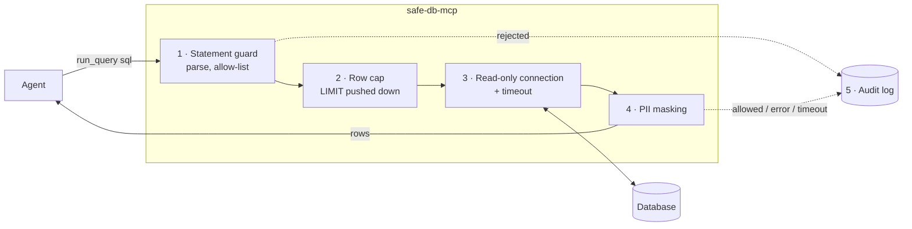

# safe-db-mcp

**Let an AI agent query your database without letting it break anything or leak anyone's data.**

`safe-db-mcp` is a small [Model Context Protocol](https://modelcontextprotocol.io) server that gives an agent
(Claude Code, Claude Desktop or any MCP client) read-only SQL access to SQLite or MySQL, behind production-style
guardrails: a statement allow-list, a read-only connection, row caps, query timeouts, PII masking and an audit log of
every call.

```text
> Clean up cancelled orders
  run_query({"sql": "DELETE FROM orders WHERE status = 'cancelled'"})
  ✗ Query rejected: DELETE statements are not allowed; only SELECT, SHOW, DESCRIBE and EXPLAIN are

> Show me a few customers
  run_query({"sql": "SELECT id, full_name, email, phone, city FROM customers LIMIT 3"})
  ✓ [1, 'Kofi Evans', '[masked]', '[masked]', 'Springfield']
```

## Why this exists

Picture a new analyst on their first day. They're smart and fast, and they're very eager to help. You'd happily let them
*ask* the database questions. You would not give them the admin password, let them run `DELETE` "to tidy up", or let
them copy the customer phone list into a chat window.

An AI agent with a database tool is that analyst, with two differences. It works a hundred times faster, and anyone who
can put text in front of it (a support ticket, a web page, a row in the table it just read) can try to talk it into
something. A plain "run SQL" tool hands it the master key and hopes for the best.

I'm a backend engineer in fintech, where a wrong query can cost real money and a leaked phone number is a regulatory
incident. So when an agent gets near production data, the question that matters isn't whether it's clever enough. It's
**what's the worst thing it can do on a bad day?** This project is my answer, written from scratch as a generic,
open-source version of that idea. No single check is trusted on its own. Each layer assumes the one before it might
fail.

## How it works



| # | Layer | What it does | Why it's built this way |
|---|-------|--------------|-------------------------|
| 1 | **Statement guard** ([`guards.py`](src/safe_db_mcp/guards.py)) | Parses the SQL into a syntax tree with [sqlglot](https://github.com/tobymao/sqlglot) and allows exactly one `SELECT`, `SHOW`, `DESCRIBE` or `EXPLAIN`. It walks the whole tree to reject writes hidden inside (`WITH … DELETE`, `SELECT … INTO`), row locks (`FOR UPDATE`), dangerous functions (`SLEEP`, `BENCHMARK`, `LOAD_FILE`, `load_extension`, `randomblob`), leaky `SHOW`s (`PROCESSLIST`, `GRANTS`) and `EXPLAIN ANALYZE`, which actually runs the query. | A keyword blacklist is a bouncer reading name tags, and `DELETE/**/FROM` or `SELECT 1; DROP …` walk straight past it. A parser reads the sentence the way the database will. **Anything it can't parse is rejected**: unknown means no. |
| 2 | **Row cap** ([`guards.py`](src/safe_db_mcp/guards.py) · [`database.py`](src/safe_db_mcp/database.py)) | Rewrites `SELECT`s to `LIMIT max_rows + 1`, so the database stops early, then fetches at most that many rows and tells the agent when the result was cut short. | Protects both the database and the agent's context window. The extra row is how we tell "exactly 200 rows" from "200 of a million". The rewritten SQL is generated from the same tree the guard checked, so **what runs is what was checked**. |
| 3 | **Read-only connection + timeout** ([`database.py`](src/safe_db_mcp/database.py)) | SQLite opens with `mode=ro` and `PRAGMA query_only`. MySQL runs `SET SESSION TRANSACTION READ ONLY` and `MAX_EXECUTION_TIME`, with a socket read timeout as a backstop. SQLite has no statement timeout, so a progress handler aborts the query at the deadline. | Belt and braces: even if a write slipped past layer 1, the database refuses it. The tests prove this by sending `DELETE`s straight to the connection, **as MySQL root**. |
| 4 | **PII masking** ([`guards.py`](src/safe_db_mcp/guards.py) · [`runner.py`](src/safe_db_mcp/runner.py)) | Values in configured columns (e.g. `email,phone`) come back as `[masked]`. Those columns may be selected only as-is, at the top level of the query. | Masking by column name alone is easy to dodge: `email AS x`, `lower(email)`, `UNION`, subqueries. Filtering or sorting on a masked column (`WHERE email LIKE 'a%'`) lets an agent guess the value one question at a time. Those patterns are rejected. |
| 5 | **Audit log** ([`audit.py`](src/safe_db_mcp/audit.py)) | One JSON line per tool call, whether it was allowed, rejected, failed or timed out. Each line has the original SQL, the SQL actually executed, the row count, the duration and the reason. The file is created owner-only (`0600`). | When someone asks "what did the agent look at last Tuesday?", there's an answer. |
| 6 | **Credentials out of reach** ([`config.py`](src/safe_db_mcp/config.py)) | Connection settings come from environment variables. The password comes from `SAFE_DB_PASSWORD` or the OS keychain, and it never appears in `repr()` or logs. | No tool takes a host, user or password argument, so a prompt can't redirect the server to another database or extract the secret. |

Agents get three tools, each marked `readOnlyHint`: `list_tables`, `describe_table(table_name)` and `run_query(sql)`.
Errors come back as plain sentences ("Query rejected: …", "Query timed out: … Narrow it with filters or LIMIT."), so the
agent can correct itself instead of retrying blindly.

## Quickstart

Requires Python 3.10+ and [uv](https://docs.astral.sh/uv/).

```bash
git clone https://github.com/token-hoarder/safe-db-mcp.git
cd safe-db-mcp
uv sync
```

Build the sample database (a fictional outdoor-gear shop: 200 customers, 1,000 orders; every name, `@example.com`
address and 555 number is generated):

```bash
uv run python demo/build_sample_db.py
```

Watch a scripted agent session, with good questions, bad ones and the resulting audit log:

```bash
uv run python demo/walkthrough.py
```

## Use it from Claude Code

```bash
claude mcp add safe-db \
  -e SAFE_DB_DIALECT=sqlite \
  -e SAFE_DB_SQLITE_PATH="$PWD/demo/shop.db" \
  -e SAFE_DB_MASKED_COLUMNS=email,phone \
  -- uv --directory "$PWD" run safe-db-mcp
```

Then ask Claude something like *"Which product category made the most money in March?"* or *"Delete the cancelled
orders"*, and watch the second one get refused.

For Claude Desktop, add the same thing to `claude_desktop_config.json`:

```json
{
  "mcpServers": {
    "safe-db": {
      "command": "uv",
      "args": ["--directory", "/absolute/path/to/safe-db-mcp", "run", "safe-db-mcp"],
      "env": {
        "SAFE_DB_DIALECT": "sqlite",
        "SAFE_DB_SQLITE_PATH": "/absolute/path/to/safe-db-mcp/demo/shop.db",
        "SAFE_DB_MASKED_COLUMNS": "email,phone"
      }
    }
  }
}
```

## Configuration

| Variable | Default | Meaning |
|----------|---------|---------|
| `SAFE_DB_DIALECT` | *required* | `sqlite` or `mysql` |
| `SAFE_DB_SQLITE_PATH` | *required for SQLite* | Path to the database file (opened read-only) |
| `SAFE_DB_HOST`, `SAFE_DB_PORT`, `SAFE_DB_USER`, `SAFE_DB_NAME` | port `3306` | MySQL connection |
| `SAFE_DB_PASSWORD` | OS keychain | MySQL password. If unset, read from the keychain entry `safe-db-mcp` / `<user>` |
| `SAFE_DB_MAX_ROWS` | `200` | Most rows returned per query |
| `SAFE_DB_TIMEOUT_SECONDS` | `10` | Per-query time limit |
| `SAFE_DB_MASKED_COLUMNS` | none | Comma-separated column names to mask, case-insensitive |
| `SAFE_DB_AUDIT_LOG` | `~/.safe-db-mcp/audit.jsonl` | Where the audit log is appended |

### MySQL

```bash
uv sync --extra mysql --extra keychain
```

Give the server its own login that can only read. That's the strongest guard of all, and it doesn't depend on this
code being right:

```sql
CREATE USER 'agent_reader'@'%' IDENTIFIED BY '...';
GRANT SELECT, SHOW VIEW ON shop.* TO 'agent_reader'@'%';
```

Then store the password in the OS keychain instead of a config file:

```bash
uv run keyring set safe-db-mcp agent_reader
```

## Tests and evals

```bash
uv run pytest
```

There are 116 unit tests covering the guards, the database layer, config, the audit log and the MCP server end to
end (in-memory client). Seven more MySQL integration tests run against a throwaway container:

```bash
docker run -d --name safe-db-mcp-test-mysql -e MYSQL_ROOT_PASSWORD=test-only-root-pw -e MYSQL_DATABASE=shop -p 127.0.0.1:33061:3306 mysql:8.4
SAFE_DB_TEST_MYSQL_PORT=33061 SAFE_DB_TEST_MYSQL_PASSWORD=test-only-root-pw uv run pytest tests/test_mysql_integration.py
```

The **eval** ([`evals/run_evals.py`](evals/run_evals.py)) starts the real server over stdio, the way an agent would,
and sends it [46 queries](evals/cases.json): legitimate analytics plus attacks a confused or manipulated agent might
try. A case passes only if the outcome matches (allow / reject / timeout). The whole run fails if any response contains
a real email or phone number, if the database file's hash changes, or if any call is missing from the audit log.

```bash
uv run python evals/run_evals.py
```

```text
category                       passed
-------------------------------------
legitimate analytics            9/9
writes and schema changes       8/8
smuggled statements             6/6
engine and file access          6/6
resource exhaustion             4/4
PII exfiltration               11/11
not SQL                         2/2
-------------------------------------
total                          46/46

database file unchanged: yes
audit log entries:       46 for 46 calls
```

The legitimate cases matter as much as the attacks. A guard that blocks everything is useless, and false refusals
teach people to switch it off.

## Known limits

This is defence in depth, not a proof. Specifically:

- **Masking works on column names.** A view or another table that holds the same data under a different name isn't
  covered. Real enforcement belongs in the database: views without the PII, column-level grants. Masked columns also
  can't be filtered or sorted, which is a deliberate trade of convenience for safety.
- **The parser isn't the database.** sqlglot and SQLite or MySQL could disagree about an odd piece of syntax. Layer 3
  exists for that case. For `SELECT`s, the executed SQL is regenerated from the checked tree, which narrows the gap.
- **MySQL's `MAX_EXECUTION_TIME` only covers `SELECT`.** `SHOW` and `DESCRIBE` rely on the socket read timeout.
- **Data can carry instructions.** A row containing "ignore previous instructions…" is returned like any other value.
  The server stops the agent from *acting* on the database, but it can't stop the agent from *reading* text that tries
  to steer it. Treat query results as untrusted input in your agent loop.
- **The audit log is a local file.** It's append-only by convention, not tamper-proof. In production, ship it to your
  log pipeline.
- **SQLite and MySQL only.** Postgres would need its own backend (`default_transaction_read_only`, `statement_timeout`).

## Project layout

```text
src/safe_db_mcp/
  guards.py     statement allow-list, row-limit rewrite, masking rules
  database.py   read-only SQLite / MySQL backends, row cap, timeouts
  runner.py     check → cap → execute → mask → audit, in that order
  audit.py      JSON-lines audit log
  config.py     settings from env, password from env or keychain
  server.py     MCP tools over stdio
demo/           sample-data builder and scripted walkthrough
evals/          attack and legitimate-use cases, eval runner
tests/          unit, MCP end-to-end and MySQL integration tests
```

## License

[MIT](LICENSE)
